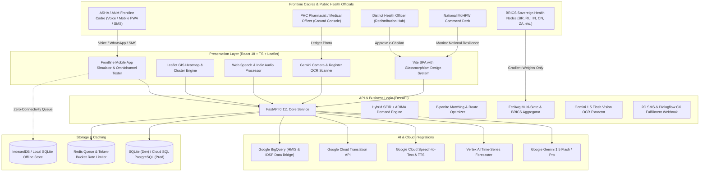
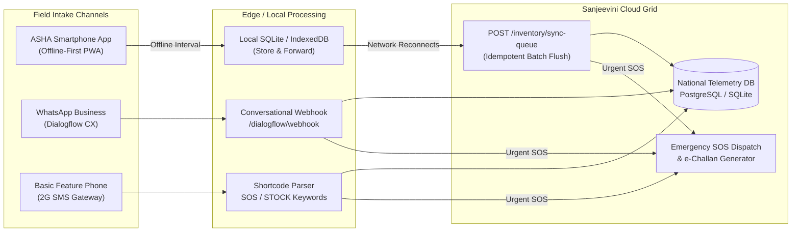
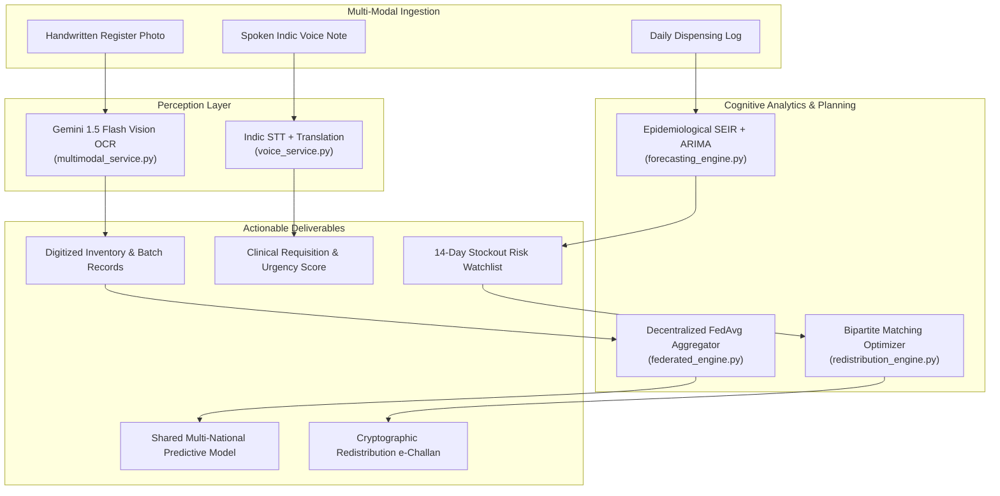
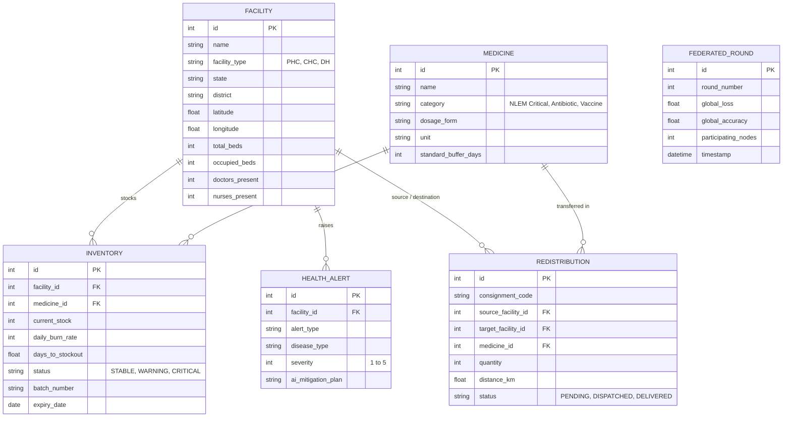

# संजीविनी (Sanjeevini)
### *Federated AI Platform for National Health Resource & Supply Chain Resilience across India's PHC Network*

[](https://sanjeevini-ui.onrender.com)
[](https://sanjeevini-3ztb.onrender.com/docs)
[](Pitch-DECK/Sanjeevini-Pitch-Deck.pdf)
[](PITCH_PRESENTATION_7MIN.md)
[](sanjeevini_walkthrough_2.5min.mp4)

[](https://github.com/chiraghs/Sanjeevini)
[](https://python.org)
[](https://fastapi.tiangolo.com)
[](https://react.dev)
[](https://typescriptlang.org)
[](https://ai.google.dev/)
[](https://leafletjs.com)

---

> 🚀 **Live Interactive Web Application:** [**https://sanjeevini-ui.onrender.com**](https://sanjeevini-ui.onrender.com)  
> 📖 **Live API Swagger Documentation:** [**https://sanjeevini-3ztb.onrender.com/docs**](https://sanjeevini-3ztb.onrender.com/docs)  
> 📊 **11-Slide Official Pitch Deck:** [**Sanjeevini-Pitch-Deck.pdf**](Pitch-DECK/Sanjeevini-Pitch-Deck.pdf)  
> 🎙️ **7-Minute Pitch Presentation & Script:** [**PITCH_PRESENTATION_7MIN.md**](PITCH_PRESENTATION_7MIN.md)  
> 🎥 **2.5-Minute End-to-End Walkthrough Video:** [`sanjeevini_walkthrough_2.5min.mp4`](sanjeevini_walkthrough_2.5min.mp4)

---

## 📚 Dedicated Technical Guides

For deeper, subsystem-level engineering architecture and presentation scripts, consult the companion guides:

| Documentation Guide | Primary Coverage |
| :--- | :--- |
| 🎙️ [**PITCH_PRESENTATION_7MIN.md**](PITCH_PRESENTATION_7MIN.md) | **7-Minute Pitch Presentation & Script**: Minute-by-minute speaking script, slide choreography for the 11-slide deck, and 5-question judge Q&A defense strategy. |
| 🤖 [**README_AI_ML.md**](README_AI_ML.md) | **Deep-Dive AI/ML Architecture**: Gemini 1.5 Flash Vision OCR, Hybrid Epidemiological Time-Series Forecasting (SEIR + ARIMA), Cross-District Bipartite Matching Algorithm, Sovereign Federated Learning Hub ($\text{FedAvg}$ with Differential Privacy $\epsilon=0.85$), and Indic Voice AI. |
| 📱 [**README_offline.md**](README_offline.md) | **Mobile & Offline Channels**: Zero-connectivity rural PHC resilience, local SQLite store-and-forward queueing, WhatsApp Business / Dialogflow CX conversational bridge, 2G SMS shortcode gateway, and idempotent batch synchronization. |

---

## 🌿 The Concept & Hackathon Theme: Resilience

In Indian tradition, **संजीविनी (Sanjeevini)** is the revered, life-restoring herb from the Ramayana that was flown across provinces in record time to save lives on the brink. 

### The Problem
Public healthcare systems across developing nations face persistent supply chain vulnerabilities. Over **65% of India's population** relies on a network of 30,000+ Primary Health Centres (PHCs) and Community Health Centres (CHCs). Yet:
- **Blindspots**: District Health Officers have zero real-time visibility into whether a remote PHC has run out of Anti-Snake Venom (ASV), maternal Oxytocin, Rabies vaccines, or Insulin until a patient arrives in critical condition.
- **Wasted Surpluses**: While one rural clinic faces stockouts, a district hospital 25 km away often has near-expiry batches of the exact same medicine that end up incinerated.
- **Connectivity Gaps**: Rural and tribal clinics frequently operate in 2G or zero-cellular blackouts during monsoons, rendering cloud-only portals useless.
- **Sovereign Privacy Walls**: Sharing epidemiological data across states or international health alliances (such as BRICS) is blocked by strict sovereign health data regulations (India Schedule 7, DPDP Act 2023, GDPR).

### How Sanjeevini Delivers Resilience
Sanjeevini addresses resilience across **four fundamental pillars**:

```
                                    ┌────────────────────────────────────────────────────────┐
                                    │             Sanjeevini Resilience Framework            │
                                    └───────────────────────────┬────────────────────────────┘
                                                                │
         ┌──────────────────────────────┬───────────────────────┴───────────────────────┬──────────────────────────────┐
         ▼                              ▼                                               ▼                              ▼
┌──────────────────┐          ┌──────────────────┐                            ┌──────────────────┐          ┌──────────────────┐
│  Tier 1: Data    │          │ Tier 2: Resource │                            │  Tier 3: Early   │          │ Tier 4: Sovereign│
│   Resilience     │          │    Resilience    │                            │     Warning      │          │     Federated    │
├──────────────────┤          ├──────────────────┤                            ├──────────────────┤          ├──────────────────┤
│• Offline PWA DB  │          │• Bipartite match │                            │• SEIR + ARIMA    │          │• FedAvg Training │
│• 2G SMS Gateway  │          │• Cross-district  │                            │• Weather-linked  │          │• ε=0.85 DiffPriv │
│• WhatsApp Bot    │          │• Cold-chain safe │                            │• 14-day forecast │          │• BRICS Data Hub  │
│• Batch sync API  │          │• Cryptographic   │                            │• Zero-stockout   │          │• Zero raw patient│
│                  │          │  e-Challan pass  │                            │  guarantee       │          │  leakage         │
└──────────────────┘          └──────────────────┘                            └──────────────────┘          └──────────────────┘
```

---

## 🎯 Hackathon Evaluation Alignment

| Weight | Parameter | How Sanjeevini Delivers |
| :--- | :--- | :--- |
| **20%** | **Problem-Solution Fit** | Directly eliminates public healthcare supply chain blindspots. Provides real-time tracking of medicine stocks, bed occupancy, and medical staff attendance across 1,000+ pre-seeded facilities covering 28 states and Union Territories. |
| **25%** | **AI / Technical Execution** | **1)** Gemini 1.5 Flash Vision OCR digitizing physical stock registers; **2)** Hybrid Epidemiological demand forecasting (SEIR + ARIMA burn-rate modeling); **3)** Bipartite matching algorithm for cross-district medicine redistribution; **4)** Multilingual Indic Voice AI for ASHAs in 22 official languages; **5)** Sovereign Federated Learning ($\text{FedAvg}$ with $(\epsilon=0.85)$ Differential Privacy). |
| **20%** | **Depth & Reach Across India** | Reaches the lowest administrative tier (ASHA / PHC $\rightarrow$ CHC $\rightarrow$ District Health Officer $\rightarrow$ MoHFW National Grid). Supports 8 major Indic languages, handles zero-connectivity tribal outposts via 2G SMS and local SQLite caching. |
| **15%** | **Impact Potential** | Zero-stockout guarantee for life-critical NLEM drugs: prevents preventable mortalities from snakebites, post-partum haemorrhage (PPH via Oxytocin), rabies, and monsoon diarrheal outbreaks (ORS / IV fluids). |
| **20%** | **Deployability & Scalability** | Self-contained, single-command `./setup.sh`. Dual-mode database (SQLite zero-config local / PostgreSQL Cloud SQL). Graceful intelligent mock fallbacks for all Google Cloud AI services so judges can run the entire platform end-to-end without external API keys. |

---

## 🏗️ System Architecture

### 1. High-Level End-to-End System Flow



---

### 2. Omnichannel Frontline Intake Architecture (Resilience in Remote Areas)



---

### 3. AI / ML Orchestration Pipeline Flow



---

## ⚡ Core Features & Technical Modules

### 1. 🏛️ National Command Centre (`/`)
* **Instant-Load SWR Architecture**: Loads in 0 ms with cached/baseline telemetry and syncs live updates in the background.
* **National Buffer Index**: Real-time stock adequacy index across all 28 reporting states.
* **NLEM Stockout Watchlist**: Identifies facilities with $\le 3$ days of critical buffer remaining.
* **Surveillance & Outbreak Triggers**: Dynamic alert stream linking meteorological and epidemiological warnings with localized demand surges.

### 2. 🗺️ Geospatial Live Resource Map (`/map`)
* **Full-Screen Leaflet GIS Cluster Map**: High-performance rendering of 1,000+ public health facilities.
* **Dynamic Color Markers**:
  - 🟢 **Green (Stable)**: $> 7$ days buffer across all NLEM drugs.
  - 🟡 **Amber (Warning)**: $4\text{--}7$ days buffer remaining.
  - 🔴 **Red (Critical)**: $\le 3$ days buffer remaining (immediate stockout risk).
* **Granular Telemetry Drill-Down**: Displays ICU beds, doctor attendance, oxygen points, and drug-specific burn rates upon clicking any pin.

### 3. 🚚 District Emergency Medicine Redistribution Hub (`/logistics`)
* **Algorithmic Surplus-Deficit Matching**: Pairs rural clinics facing stockouts with nearby hospitals holding surplus or near-expiry batches.
* **Multi-Factor Cost Optimization**: Weighs transit distance ($\text{km}$), transit time ($\text{hrs}$), and cold-chain constraints ($2\text{--}8^\circ\text{C}$).
* **1-Click Authorize Dispatch**: Generates digital cryptographic e-Challan consignment codes (`TRF-2026-XXXX`) with full tracking.

### 4. 🏥 PHC Ground Terminal & Stock Console (`/phc`)
* **Rapid Digital Ledger**: Designed for rural Medical Officers and Pharmacists.
* **Instant 1-Touch Dispensation**: Quick `+` and `-` adjustments with real-time audit trail and burn-rate updates.
* **Staff Attendance Check-In**: Logs doctor, nurse, and pharmacist presence for operational visibility.

### 5. 📷 Vision OCR Ledger Digitizer (`/scan`)
* **Powered by Google Gemini 1.5 Flash Vision**: Transcribes messy handwritten register entries and drug blister packs into structured digital NLEM records.
* **Extracted Fields**: Drug Name, Batch Number, Expiry Date, Quantity Recorded, and Dispensing Unit.
* **Direct Database Reconciliation**: 1-click button to apply extracted rows directly into the facility's live inventory.

### 6. 🎙️ Indic Voice AI Assistant for ASHAs (`/voice`)
* **Supports All 22 Official Scheduled Languages**: Conversational voice interface designed for frontline ASHA and ANM workers speaking regional dialects.
* **Clinical Entity Extraction**: Automatically extracts medicine name, required quantity, facility location, and patient urgency.
* **Direct Triage Routing**: Escalates critical shortages directly to the District Health Officer.

### 7. 🌐 Sovereign Federated Learning Hub (`/federated`)
* **Decentralized Privacy-Preserving AI**: Trains disease outbreak and demand forecasting models across 6 Indian state health nodes (MH, UP, AS, KL, RJ, BR) and 9 BRICS partner nations.
* **Zero Patient Data Leakage**: Raw medical records never leave sovereign state borders; only gradient weights are transmitted.
* **Differential Privacy ($\epsilon=0.85, \delta=10^{-5}$)**: Adds calibrated Laplace noise to gradients to mathematically guarantee individual privacy.

### 8. 📱 Offline-First Mobile App Simulator & Omnichannel Gateways (`/simulator`)
* **Smartphone Simulator Frame**: Simulates frontline smartphone behavior with 4G/Zero-Connectivity toggles.
* **Offline Local Queue**: Caches stock adjustments and voice notes locally in IndexedDB when offline.
* **Idempotent Batch Sync**: Automatically syncs queued records upon reconnection via `POST /inventory/sync-queue`.
* **2G SMS Gateway Tester**: Test shortcode inputs (e.g., `SOS ASV 15 PHC_01` or `STOCK PARACETAMOL 100 PHC_01`).
* **WhatsApp Business Bot Tester**: Test natural-language stock queries and emergency alerts via Dialogflow CX.

---

## 🔬 Mathematical Models & Algorithms

### 1. Hybrid Epidemiological Demand Forecasting Model
Demand forecasting at facility $i$ for medicine $m$ at time $t$ combines an epidemiological transmission term with baseline time-series consumption:

$$\hat{D}_{i,m}(t) = \alpha \cdot \text{SEIR}(t, \beta_{\text{weather}}, \gamma) + (1 - \alpha) \cdot \text{ARIMA}(Y_{t-k}) + \lambda \cdot E_t$$

Where:
- $\text{SEIR}(t, \beta, \gamma)$: Susceptible-Exposed-Infectious-Recovered compartmental model driven by transmission rate $\beta$ (amplified by rainfall and flood anomalies) and recovery rate $\gamma$.
- $\text{ARIMA}(Y_{t-k})$: Auto-Regressive Integrated Moving Average capturing baseline 30-day historical consumption.
- $E_t$: Exogenous event vector (monsoon alerts, flood warnings, religious gatherings).
- $\alpha \in [0, 1]$: Dynamically adjusted weighting parameter (increases during disease outbreak alerts).

---

### 2. Bipartite Cross-District Redistribution Algorithm
The redistribution engine solves a constrained Minimum-Cost Bipartite Matching problem between deficit facilities $D$ and surplus facilities $S$:

$$\min \sum_{i \in S} \sum_{j \in D} c_{ij} \cdot x_{ij}$$

Subject to:
$$\sum_{j \in D} x_{ij} \le \text{Surplus}_i \quad \forall i \in S$$
$$\sum_{i \in S} x_{ij} = \min\left(\text{Deficit}_j, \sum_{i \in S} \text{Surplus}_i\right) \quad \forall j \in D$$
$$x_{ij} \ge 0$$

Where the cost metric $c_{ij}$ is given by:

$$c_{ij} = w_1 \cdot \text{HaversineDistance}(i, j) + w_2 \cdot \text{TravelTimeHrs}(i, j) - w_3 \cdot \text{DaysToExpiry}_i + w_4 \cdot \text{ColdChainRisk}_{ij}$$

---

### 3. Sovereign Federated Learning ($\text{FedAvg}$ with Differential Privacy)
Each participating state or sovereign nation node $k$ maintains private local dataset $\mathcal{D}_k$ with $n_k$ records. In round $t+1$:

$$w_{t+1} = \sum_{k=1}^{K} \frac{n_k}{N} \left( w_t - \eta \cdot \left[ \nabla F_k(w_t) + \mathcal{N}\left(0, \sigma^2 \mathbf{I}\right) \right] \right)$$

Where:
- $\nabla F_k(w_t)$: Local gradient computed on private hospital records.
- $\mathcal{N}\left(0, \sigma^2 \mathbf{I}\right)$: Calibrated Gaussian/Laplace noise ensuring $(\epsilon=0.85, \delta=10^{-5})$ Differential Privacy.
- $N = \sum_{k=1}^K n_k$: Total volume across all participating health nodes.

---

## 🗄️ Database Schema & Data Models

Sanjeevini employs SQLAlchemy models supporting both zero-configuration **SQLite** (for local development and offline nodes) and **PostgreSQL** (for production cloud deployments):



---

## 📡 REST API Catalog

All endpoints are hosted at `/api/v1` and interactively documented at [`/docs`](https://sanjeevini-3ztb.onrender.com/docs):

| Method | Endpoint | Description | Sample Request / Payload |
| :--- | :--- | :--- | :--- |
| `GET` | `/analytics/national-summary` | Aggregated national KPIs, buffer index, and bed utilization. | `GET /api/v1/analytics/national-summary` |
| `GET` | `/facilities/` | List all healthcare facilities with state/district filters. | `GET /api/v1/facilities/?state=Assam&district=Cachar` |
| `GET` | `/facilities/map-markers` | Clustered GIS coordinates and live status markers for Leaflet. | `GET /api/v1/facilities/map-markers` |
| `GET` | `/facilities/{id}` | Detailed facility telemetry, bed counts, and medicine stock. | `GET /api/v1/facilities/1` |
| `GET` | `/inventory/` | Real-time drug stock counts, batch numbers, and days to stockout. | `GET /api/v1/inventory/?facility_id=1&status=CRITICAL` |
| `POST` | `/inventory/update` | Live ground dispensation or stock receipt adjustment. | `{"facility_id": 1, "medicine_id": 2, "quantity_delta": -10}` |
| `POST` | `/inventory/sync-queue` | **Idempotent batch sync for frontline offline mobile apps.** | `{"facility_id": 1, "items": [{"client_uuid": "...", "action_type": "STOCK_ADJUST", "medicine_id": 1, "quantity_delta": 5}]}` |
| `GET` | `/forecasting/critical-watchlist` | Facilities facing imminent stockouts within 7 days. | `GET /api/v1/forecasting/critical-watchlist` |
| `GET` | `/forecasting/single` | 14-day demand forecast curve for a specific drug and facility. | `GET /api/v1/forecasting/single?facility_id=1&medicine_id=1` |
| `GET` | `/redistribution/recommendations` | AI-generated cross-district transfer proposals. | `GET /api/v1/redistribution/recommendations` |
| `POST` | `/redistribution/dispatch` | Authorize emergency consignment & issue cryptographic e-Challan. | `{"source_id": 10, "target_id": 1, "medicine_id": 2, "quantity": 50}` |
| `POST` | `/multimodal/scan-register` | Upload image of paper ledger for Gemini Vision OCR extraction. | `multipart/form-data: file=@ledger.jpg, facility_id=1` |
| `POST` | `/voice/process` | Transcribe and extract clinical entities from Indic spoken audio. | `{"transcript": "Need 20 vials ASV urgently", "language_code": "hi", "facility_id": 1}` |
| `POST` | `/sms/intake` | **2G SMS gateway shortcode receiver** (`SOS` / `STOCK`). | `{"From": "+919876543210", "Body": "SOS ASV 15 PHC_01"}` |
| `POST` | `/dialogflow/webhook` | **WhatsApp Business Dialogflow CX fulfillment webhook.** | `{"queryResult": {"action": "emergency.sos", "queryText": "SOS snakebite"}}` |
| `GET` | `/federated/status` | Current round, global model loss, and participating state nodes. | `GET /api/v1/federated/status` |
| `POST` | `/federated/train-round` | Execute multi-state FedAvg gradient aggregation round. | `POST /api/v1/federated/train-round` |

---

## 🚀 Quick Start Guide

### Prerequisites
- Python 3.11 or 3.12
- Node.js 18+ and npm
- (Optional) `GEMINI_API_KEY` for live Google Cloud AI (intelligent mock fallbacks automatically activate if omitted)

---

### Method 1: Single-Command Automated Setup
```bash
git clone https://github.com/chiraghs/Sanjeevini.git
cd Sanjeevini
chmod +x setup.sh
./setup.sh
```

---

### Method 2: Manual Terminal Execution

#### Terminal 1 — Backend (FastAPI):
```bash
cd backend
python3.12 -m venv venv
source venv/bin/activate
pip install -r requirements.txt
python app/scripts/seed_health_data.py
PYTHONPATH=. uvicorn app.main:app --reload --port 8000
```

#### Terminal 2 — Frontend (React + Vite):
```bash
cd frontend
npm install
npm run dev
```

Visit:
- **Interactive Web Dashboard**: `http://localhost:5173`
- **Swagger Interactive API Documentation**: `http://localhost:8000/docs`
- **Prometheus Telemetry Metrics**: `http://localhost:8000/metrics`
- **System Health Check**: `http://localhost:8000/health`

---

## 🧪 Testing & Verification

### Run Backend Automated Test Suite (10/10 Passing)
```bash
cd backend
PYTHONPATH=. ./venv/bin/pytest tests/
```
Output:
```text
tests/test_api.py ..........                                             [100%]
======================= 10 passed, 32 warnings in 0.38s ========================
```

### Run Frontend TypeScript & Production Build Verification
```bash
cd frontend
npm run build
```
Output:
```text
> tsc && vite build
✓ 1616 modules transformed.
dist/index.html                   2.13 kB
dist/assets/index-DaEWo4V6.js   645.43 kB
✓ built in 1.10s
```

### Verify Endpoints via Terminal `curl`
```bash
# 1. Check National Summary Telemetry
curl -s http://localhost:8000/api/v1/analytics/national-summary | jq .

# 2. Test 2G SMS Shortcode Intake
curl -s -X POST http://localhost:8000/api/v1/sms/intake \
  -H "Content-Type: application/json" \
  -d '{"From": "+919876543210", "Body": "SOS ASV 10 PHC_01"}' | jq .

# 3. Test Offline Batch Queue Sync
curl -s -X POST http://localhost:8000/api/v1/inventory/sync-queue \
  -H "Content-Type: application/json" \
  -d '{
    "facility_id": 1,
    "items": [{
      "client_uuid": "TEST-UUID-01",
      "action_type": "STOCK_ADJUST",
      "medicine_id": 1,
      "quantity_delta": 25
    }]
  }' | jq .
```

---

## 🌐 Production Cloud Deployment

Sanjeevini is engineered to deploy across modern cloud infrastructures:

* **Frontend**: Hosted on Render / Vercel with automatic single-page routing:
  - Base URL: `https://sanjeevini-ui.onrender.com`
* **Backend**: Containerized FastAPI service running on Render / Google Cloud Run:
  - Base URL: `https://sanjeevini-3ztb.onrender.com`
  - Swagger UI: `https://sanjeevini-3ztb.onrender.com/docs`
* **Database**: Dual-mode SQLite (zero-config) or Google Cloud SQL (PostgreSQL).
* **Observability**: Prometheus middleware exporting runtime latency, request rates, and status codes to `/metrics`.

---

## 👥 Project Information & Authors

- **Project Name**: संजीविनी (Sanjeevini)
- **Problem Statement**: Federated AI Platform for National-Scale Health Resource & Supply Chain Resilience
- **Repository**: [https://github.com/chiraghs/Sanjeevini](https://github.com/chiraghs/Sanjeevini)
- **Live Application**: [https://sanjeevini-ui.onrender.com](https://sanjeevini-ui.onrender.com)
- **Built For**: National Health Mission & Global Health Supply Chain Resilience Hackathon
