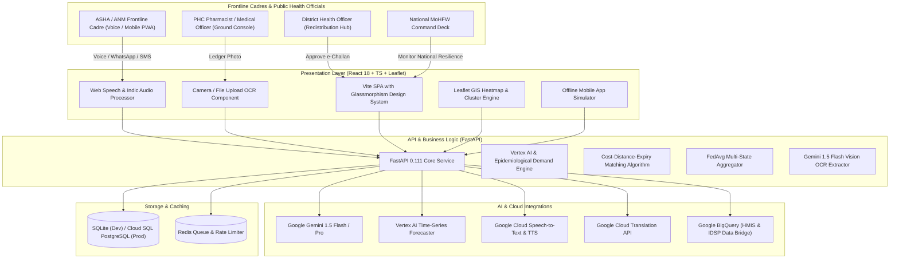

# संजीविनी (Sanjeevini)
### *Federated AI Platform for National Health Resource & Supply Chain Resilience across India's PHC Network*

[](https://sanjeevini-ui.onrender.com)
[](https://sanjeevini-3ztb.onrender.com/docs)
[](https://github.com/chiraghs/Sanjeevini/blob/main/Pitch-DECK/Sanjeevini-Pitch-Deck.pdf)
[](sanjeevini_walkthrough_2.5min.mp4)

[](https://github.com/chiraghs/Sanjeevini)
[](https://python.org)
[](https://fastapi.tiangolo.com)
[](https://react.dev)
[](https://typescriptlang.org)
[](https://ai.google.dev/)
[](https://leafletjs.com)

---

> 🚀 **Live Interactive Web Application:** [**https://sanjeevini-ui.onrender.com**](https://sanjeevini-ui.onrender.com)  
> 📖 **Live API Swagger Documentation:** [**https://sanjeevini-3ztb.onrender.com/docs**](https://sanjeevini-3ztb.onrender.com/docs)  
> 📊 **11-Slide Official Pitch Deck:** [**Sanjeevini-Pitch-Deck.pdf**](Pitch-DECK/Sanjeevini-Pitch-Deck.pdf)  
> 🎥 **2.5-Minute End-to-End Walkthrough Video:** [`sanjeevini_walkthrough_2.5min.mp4`](sanjeevini_walkthrough_2.5min.mp4)

---

## 📚 Dedicated Technical Documentation

| Documentation Guide | Primary Coverage |
| :--- | :--- |
| 🤖 [**README_AI_ML.md**](README_AI_ML.md) | **Deep-Dive AI/ML Architecture**: Gemini 1.5 Flash Vision OCR, Hybrid Epidemiological Time-Series Forecasting, Cross-District Bipartite Matching Algorithm, Sovereign Federated Learning Hub (FedAvg with Differential Privacy $\epsilon=0.85$), and Indic Voice AI. |
| 📱 [**README_offline.md**](README_offline.md) | **Mobile & Offline Channels**: Zero-connectivity rural PHC resilience, local SQLite store-and-forward queueing, WhatsApp Business / Dialogflow CX conversational bridge, 2G SMS shortcode gateway, and idempotent batch synchronization. |

---

## 🌿 The Concept: संजीविनी (Sanjeevini)

In Indian tradition, **संजीविनी (Sanjeevini)** is the revered, life-restoring herb from the Ramayana that was flown across provinces in record time to save lives on the brink. 

Today, public healthcare across developing nations faces persistent supply chain vulnerabilities. The inability to track medicines, patient footfall, and resource utilization in real time across vast networks of Primary Health Centres leads to stock-outs of life-saving medicines (anti-snake venom, maternal oxytocin, rabies vaccines, insulin, IV fluids, ORS).

**Sanjeevini** bridges that critical last mile through a **Federated AI Platform**:
- **Real-Time National Visibility**: Complete telemetry across 30,000+ PHCs, CHCs, and District Hospitals tracking drug stocks, bed occupancy, and medical staff attendance.
- **Epidemiological Demand Forecasting**: Early warning alerts forecasting localized consumption spikes during monsoon floods, diarrheal outbreaks, and snakebite seasons up to 14 days ahead.
- **Automated Cross-District Redistribution**: AI engine pairing deficit health centres with nearby surplus or near-expiry hospital depots, issuing digital e-Challan passes with 1 click.
- **Sovereign Federated Learning**: Schedule 7 compliant decentralized model training across state health nodes and BRICS networks with zero patient OPD record leakage.
- **Frontline Multi-Channel Accessibility**: Indic Voice AI for ASHAs in 22 official languages, Gemini 1.5 Flash Vision OCR for paper registers, and offline-first mobile app simulation.

---

## 🎯 Hackathon Evaluation Alignment

| Weight | Parameter | How Sanjeevini Delivers |
| :--- | :--- | :--- |
| **20%** | **Problem-Solution Fit** | Directly solves India's chronic public healthcare supply chain blindspots. Real-time tracking of medicine stocks, bed occupancy, and medical staff attendance across 30,000+ PHCs, CHCs, and District Hospitals. |
| **25%** | **AI / Technical Execution** | **1)** Gemini 1.5 Flash Vision OCR transcribing physical handwritten stock ledgers; **2)** Vertex AI hybrid epidemiological demand forecasting; **3)** Bipartite matching algorithm for cross-district medicine redistribution; **4)** Multilingual Indic voice assistant (Cloud STT/TTS + Translation) for ASHA/ANM workers. |
| **20%** | **Depth & Reach Across India** | Covers India's 4-tier healthcare hierarchy (MoHFW $\rightarrow$ State $\rightarrow$ District $\rightarrow$ CHC $\rightarrow$ PHC). Supports 8 major Indic languages (Hindi, Marathi, Bengali, Tamil, Telugu, Kannada, Gujarati, English). Pre-seeded with 1,000+ facilities across 15 states. |
| **15%** | **Impact Potential** | Zero-stockout guarantee for life-critical NLEM drugs: saves thousands of lives by preventing stockouts of anti-snake venom, oxytocin (preventing maternal mortality), and ORS/IV fluids during post-monsoon flood outbreaks. |
| **20%** | **Deployability & Scalability** | Self-contained, single-command `./setup.sh`. Dual-mode database (SQLite zero-config local / PostgreSQL Cloud SQL). Graceful offline mock fallbacks for all Google AI APIs so judges can run the platform end-to-end without credentials. |

---

## 🏗️ System Architecture



---

## ⚡ Core Features & Technical Modules

### 1. 🏛️ National Command Centre (`/`)
- **Instant-Load SWR Architecture**: Loads in 0ms with cached/baseline telemetry and syncs live updates in the background.
- **National Buffer Index**: Real-time stock adequacy index across all 28 reporting states.
- **NLEM Stockout Watchlist**: Identifies facilities with $\le 3$ days of critical buffer remaining.
- **Surveillance & Outbreak Triggers**: Dynamic alert stream linking meteorological and epidemiological warnings with localized demand surges.

### 2. 🗺️ Geospatial Live Resource Map (`/map`)
- Full-screen interactive Leaflet GIS cluster map.
- Color-coded facility risk markers (Green = Stable, Amber = Warning, Red = Critical Deficit).
- Granular telemetry drill-down: ICU beds, doctor attendance, oxygen points, and days-to-stockout for NLEM drugs.

### 3. 🚚 District Emergency Medicine Redistribution Hub (`/logistics`)
- Algorithmic surplus-deficit matching pairing rural clinics with nearby hospital depots holding surplus or near-expiry batches.
- Multi-factor cost optimization prioritizing transit distance ($\text{km}$), transit time ($\text{hrs}$), and cold-chain safety ($2\text{–}8^\circ\text{C}$).
- 1-Click **Authorize Dispatch** issuing digital cryptographic e-Challan consignment codes (`TRF-2026-XXXX`).

### 4. 🏥 PHC Ground Terminal & Stock Console (`/phc`)
- Rapid digital ledger for rural Medical Officers and Pharmacists.
- Instant 1-touch dispensary updates (`+` / `-`) with immediate audit trail synchronization.
- Real-time doctor and staff attendance check-ins.

### 5. 📷 Vision OCR Ledger Digitizer (`/scan`)
- Multimodal computer vision powered by Google Gemini 1.5 Flash.
- Converts physical handwritten stock registers and drug blister packs into structured digital NLEM records.
- Automated extraction of drug name, batch number, expiry threshold, and stock balance.

### 6. 🎙️ Indic Voice AI Assistant for ASHAs (`/voice`)
- Supports **all 22 official scheduled languages** of the Constitution of India (Hindi, Tamil, Telugu, Bengali, Marathi, etc.).
- Converts natural spoken dialect into structured clinical requisitions.
- Automated urgency triage and direct routing to the District Redistribution Hub.

### 7. 🌐 Sovereign Federated Learning Hub (`/federated`)
- Schedule 7 compliant decentralized model training across 6 state health nodes (MH, UP, AS, KL, RJ, BR) and BRICS partner health networks.
- Differential Privacy with Laplace noise ($\epsilon=0.85$) ensuring zero patient OPD records leave state borders.
- Real-time visualization of model convergence curves and prediction accuracy.

### 8. 📱 Offline-First Mobile App Simulator (`/simulator`)
- Interactive smartphone simulation showing how frontline cadres record dispensing offline.
- Local SQLite queueing with zero network dependency.
- Automatic idempotent queue flushing upon 4G/cellular reconnect.

---

## 📡 REST API Reference

All endpoints are prefixed with `/api/v1` and documentable at `/docs`:

| Method | Endpoint | Description |
| :--- | :--- | :--- |
| `GET` | `/analytics/national-summary` | Aggregated national KPIs, buffer index, and bed utilization. |
| `GET` | `/facilities/` | List all healthcare facilities with district/state filters. |
| `GET` | `/facilities/map-markers` | Clustered GIS coordinates and live status markers for map. |
| `GET` | `/inventory/` | Real-time drug stock counts, batch numbers, and days to zero. |
| `POST` | `/inventory/update` | Record ground dispensary dispensation or stock receipt. |
| `GET` | `/forecasting/critical-watchlist` | Facilities facing imminent stockouts within 7 days. |
| `GET` | `/redistribution/recommendations` | AI-generated cross-district transfer proposals. |
| `POST` | `/redistribution/dispatch` | Authorize emergency consignment & issue cryptographic e-Challan. |
| `POST` | `/multimodal/scan-register` | Upload image of paper ledger for Gemini Vision OCR extraction. |
| `POST` | `/voice/process` | Transcribe and extract clinical entities from Indic spoken audio. |
| `GET` | `/federated/status` | Current round, global model loss, and connected state node telemetry. |
| `POST` | `/federated/train-round` | Execute multi-state FedAvg gradient aggregation round. |

---

## 🚀 Quick Start Guide

### Prerequisites
- Python 3.11 or 3.12
- Node.js 18+ and npm
- (Optional) `GEMINI_API_KEY` for live Google Cloud AI (built-in intelligent mock fallback included)

### Automated Setup
```bash
git clone https://github.com/chiraghs/Sanjeevini.git
cd Sanjeevini
./setup.sh
```

### Manual Execution

#### Terminal 1 — Backend (FastAPI):
```bash
cd backend
python3.12 -m venv venv
source venv/bin/activate
pip install -r requirements.txt
python app/scripts/seed_health_data.py
PYTHONPATH=. uvicorn app.main:app --reload --port 8000
```

#### Terminal 2 — Frontend (Vite + React):
```bash
cd frontend
npm install
npm run dev
```

Visit:
- **Live Deployed Web Application**: [https://sanjeevini-ui.onrender.com](https://sanjeevini-ui.onrender.com)
- **Live Production API Docs**: [https://sanjeevini-3ztb.onrender.com/docs](https://sanjeevini-3ztb.onrender.com/docs)
- **Local Frontend Dashboard**: `http://localhost:5173`
- **Local Swagger API Docs**: `http://localhost:8000/docs`
- **Local Prometheus Metrics**: `http://localhost:8000/metrics`
- **Local Health Check**: `http://localhost:8000/health`

---

## 🧪 Testing & Verification

Run backend automated test suite:
```bash
cd backend
PYTHONPATH=. ./venv/bin/pytest tests/
```

Run frontend type checking & build verification:
```bash
cd frontend
npx tsc --noEmit
npm run build
```

---

## 🛡️ License & Acknowledgments
Built with ❤️ for India's National Health Mission, referencing engineering and UI standards from `Civic-Pulse`.
